# homelab-harden

[](https://github.com/LeelaKrishna-R/homelab-harden/actions/workflows/ci.yml)

A read-only security auditor for a Linux homelab server. Run it on the box and it
checks the handful of things a fresh server usually gets wrong: SSH left open to
root or passwords, no firewall, no automatic updates, no brute-force protection, a
database listening on every interface. It prints a prioritized report with a
concrete fix for each finding.

It **never changes your system.** It only reads config files and runs read-only
commands (`sshd -T`, `ufw status`, `ss`, `systemctl is-active`). Nothing it does can
break anything.



A real run of `--demo`, which audits bundled sample data so it works on any machine. Write-up: [ravuri.dev/work/homelab-harden](https://www.ravuri.dev/work/homelab-harden).

<details>
<summary>The same run as text</summary>

```
$ python3 -m homelab_harden --demo
homelab-harden  linux (sample) host

  [HIGH] SSH permits direct root login (PermitRootLogin yes)
         -> Set `PermitRootLogin no` in /etc/ssh/sshd_config and reload sshd
  [HIGH] SSH allows password authentication
         -> Set up key-based login, then set `PasswordAuthentication no` and reload sshd
  [HIGH] No active host firewall (ufw is not filtering traffic)
         -> Enable a firewall, e.g. `ufw default deny incoming && ufw enable`
  [HIGH] PostgreSQL is listening on all interfaces at port 5432 (postgres)
         -> Bind it to 127.0.0.1 or a LAN IP, or firewall the port; do not expose PostgreSQL
  [MED ] Automatic security updates are not enabled
         -> Enable unattended-upgrades (Debian/Ubuntu) or dnf-automatic.timer (RHEL/Fedora)
  [MED ] fail2ban is not running (no brute-force protection for SSH)
         -> Install and enable it: `apt install fail2ban && systemctl enable --now fail2ban`
  [MED ] Passwordless sudo is configured (1 NOPASSWD rule(s))
         -> Remove NOPASSWD from sudoers entries unless a specific automation needs it

  4 high, 3 medium, 0 low
  note: sample data shown by --demo; run without --demo on a Linux host to audit it
```

</details>

## Why

If you just stood up your first homelab server, the risky stuff is not exotic. It is
the defaults: root SSH still enabled, password login still on, no firewall, the
database container bound to `0.0.0.0` where the whole LAN can reach it. `homelab-harden`
checks those in one command so you can close them before something finds them first.

## Usage

Run it on the server you want to audit. It needs Python 3.11+ (already on virtually
every Linux box) and nothing else.

```bash
# see what it does, from any machine, with bundled sample data:
python3 -m homelab_harden --demo

# audit the real host (some checks read more when run with sudo):
sudo homelab-harden

python3 -m homelab_harden --json         # machine-readable output
homelab-harden --fail-on medium          # exit non-zero on medium+ findings
homelab-harden --ignore HH006            # leave out a rule you've accepted (repeat, or HH006,HH007)
homelab-harden --list-rules              # every rule id, its severity and what it checks
```

Run with `sudo` for the full picture: reading `/etc/shadow` (empty-password accounts)
and the effective `sshd -T` config both need root. Without root it still audits
everything it can and tells you what it skipped.

### Install

```bash
# one file, nothing to install: build it anywhere, copy it to the server, run it
python3 scripts/build_pyz.py                       # writes dist/homelab-harden.pyz
scp dist/homelab-harden.pyz server: && ssh server 'sudo python3 homelab-harden.pyz'

pipx install homelab-harden      # once it's on PyPI
# or, from source:
git clone https://github.com/LeelaKrishna-R/homelab-harden && cd homelab-harden
python3 -m homelab_harden
```

### Exit codes

| Code | Meaning |
|------|---------|
| `0`  | Clean, or only findings below the `--fail-on` threshold |
| `1`  | Findings at or above `--fail-on` (default `high`) |
| `2`  | Usage error |

## What it checks

| ID | Severity | Check |
|----|----------|-------|
| HH001 | high | SSH permits direct root login (`PermitRootLogin yes`) |
| HH002 | high | SSH allows password authentication |
| HH003 | high | SSH permits empty passwords |
| HH004 | high | No active host firewall (ufw / firewalld / nftables / iptables) |
| HH005 | medium | Automatic security updates not enabled |
| HH006 | medium | fail2ban not running |
| HH007 | medium | Passwordless sudo (`NOPASSWD`) configured |
| HH008 | high | Accounts with empty passwords |
| HH009 | high | A datastore (Postgres, MySQL, Redis, Mongo, …) listening on all interfaces |
| HH010 | low | SSH `MaxAuthTries` raised above OpenSSH's default of 6 |
| HH011 | low | SSH X11 forwarding enabled (`X11Forwarding yes`) |
| HH012 | medium | SSH lets users set their own environment (`PermitUserEnvironment` not `no`) |

It only reports things that are actually misconfigured. An SSH directive that is simply
unset, or a check it couldn't run, becomes a `note`, not a false alarm.

Firewall detection is best-effort across ufw, firewalld, nftables, and raw iptables; an
unusual setup may need a second look. Pairs well with
[homelab-audit](https://github.com/LeelaKrishna-R/homelab-audit), which does the same job
for your `docker-compose.yml`.

## Roadmap

Kept small for v0.1. Likely next:

- **Remote mode**: audit another box over SSH (`homelab-harden user@host`).
- **More checks, opt-in**: world-writable files, SUID anomalies, sysctl hardening,
  SSH key algorithms.
- **A config file** for the rules you `--ignore` every time, so cron runs stay short.
- **Release the single-file build** (`scripts/build_pyz.py`) as a download, so it runs with one `curl`.

Have a check you keep wishing existed? Open an issue.

## Development

```bash
python3 -m venv .venv && . .venv/bin/activate
pip install -e ".[dev]"
ruff check . && ruff format --check .
pytest -q
```

Tests run on any OS with no root and no network: the OS-specific collection is isolated
in one module, and everything else is pure functions over fixtures. See
[CLAUDE.md](CLAUDE.md) for conventions.

## License

MIT
